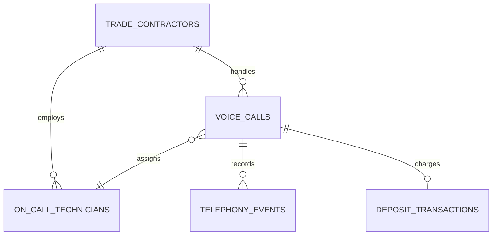

# DispatchVoice AI - Database Schema & Data Architecture Specification

> **Ultra-Low-Latency (<400ms) Voice AI Dispatcher for Field Trades & Emergency Service Contractors**  
> Architecture & Data Modeling Specification  
> Author: `@SchemaAgent`

---

## 1. Executive Architecture Overview

**DispatchVoice AI** handles high-concurrency telephony media streams (Twilio/Telnyx SIP trunking) with ultra-low latency speech-to-text (Deepgram Nova-2 streaming), Groq LPU trade reasoning, and Cartesia Sonic streaming TTS. The database captures all contractor configurations, on-call technician rotations, audio calls, live telephony events, and Stripe emergency deposit transactions.

### Core Guarantees:
1. **Sub-400ms Turnaround Auditability**: Every telephony event logs exact turn latencies (STT, LLM inference, TTS generation, network roundtrip).
2. **Deterministic Triage & Hazard Escalation**: Urgency tiers (`EMERGENCY_DISPATCH`, `NEXT_DAY`, `STANDARD_INQUIRY`) dictate automatic SMS deposit links and technician cascade triggers.
3. **Cross-Language Type Parity**: Drizzle ORM (PostgreSQL), Pydantic v2 (FastAPI), and TypeScript shared interfaces.

---

## 2. Entity-Relationship Diagram (ERD)



---

## 3. PostgreSQL SQL Definition

```sql
CREATE TYPE trade_category AS ENUM ('PLUMBING', 'HVAC', 'ELECTRICAL', 'ROOFING', 'TOWING', 'LOCKSMITH');
CREATE TYPE urgency_tier AS ENUM ('EMERGENCY_DISPATCH', 'NEXT_DAY', 'STANDARD_INQUIRY');
CREATE TYPE call_outcome AS ENUM ('BOOKED', 'DEPOSIT_PENDING', 'TRANSFERRED_TO_HUMAN', 'INFO_PROVIDED', 'ABANDONED');
CREATE TYPE crm_provider AS ENUM ('JOBBER', 'SERVICETITAN', 'HOUSECALL_PRO', 'GOOGLE_CALENDAR');
CREATE TYPE deposit_status AS ENUM ('PENDING', 'PAID', 'FAILED', 'REFUNDED');

CREATE TABLE trade_contractors (
    id UUID PRIMARY KEY DEFAULT gen_random_uuid(),
    business_name VARCHAR(150) NOT NULL,
    trade_category trade_category NOT NULL,
    forwarding_phone VARCHAR(20) NOT NULL,
    crm_provider crm_provider DEFAULT 'JOBBER',
    crm_access_token TEXT,
    emergency_diagnostic_fee NUMERIC(8, 2) DEFAULT 89.00,
    voice_agent_name VARCHAR(50) DEFAULT 'Sarah (AI Dispatcher)',
    voice_model_id VARCHAR(50) DEFAULT 'sonic-english-trade-v1',
    created_at TIMESTAMPTZ DEFAULT NOW(),
    updated_at TIMESTAMPTZ DEFAULT NOW()
);

CREATE TABLE on_call_technicians (
    id UUID PRIMARY KEY DEFAULT gen_random_uuid(),
    contractor_id UUID NOT NULL REFERENCES trade_contractors(id) ON DELETE CASCADE,
    name VARCHAR(100) NOT NULL,
    phone_number VARCHAR(20) NOT NULL,
    trade_category trade_category NOT NULL,
    zone_area VARCHAR(100) NOT NULL,
    is_on_duty BOOLEAN DEFAULT TRUE,
    priority_order INT DEFAULT 1,
    active_job_count INT DEFAULT 0,
    estimated_eta_minutes INT DEFAULT 15,
    created_at TIMESTAMPTZ DEFAULT NOW()
);

CREATE TABLE voice_calls (
    id UUID PRIMARY KEY DEFAULT gen_random_uuid(),
    contractor_id UUID NOT NULL REFERENCES trade_contractors(id) ON DELETE CASCADE,
    technician_id UUID REFERENCES on_call_technicians(id) ON DELETE SET NULL,
    caller_phone VARCHAR(20) NOT NULL,
    caller_name VARCHAR(100),
    caller_address TEXT,
    call_duration_seconds INT NOT NULL DEFAULT 0,
    turn_latency_ms INT DEFAULT 365,
    urgency urgency_tier DEFAULT 'STANDARD_INQUIRY',
    outcome call_outcome DEFAULT 'INFO_PROVIDED',
    audio_recording_url VARCHAR(512),
    full_transcript TEXT NOT NULL,
    issue_summary TEXT,
    deposit_payment_link VARCHAR(512),
    is_deposit_paid BOOLEAN DEFAULT FALSE,
    external_crm_job_id VARCHAR(100),
    customer_sentiment_score NUMERIC(3, 2) DEFAULT 0.85,
    interrupt_count INT DEFAULT 0,
    created_at TIMESTAMPTZ DEFAULT NOW()
);
CREATE INDEX idx_calls_contractor ON voice_calls(contractor_id, created_at DESC);
CREATE INDEX idx_calls_urgency ON voice_calls(urgency);

CREATE TABLE telephony_events (
    id UUID PRIMARY KEY DEFAULT gen_random_uuid(),
    call_id UUID NOT NULL REFERENCES voice_calls(id) ON DELETE CASCADE,
    event_type VARCHAR(50) NOT NULL,
    speaker VARCHAR(20) NOT NULL, -- CALLER, AGENT, SYSTEM
    message_content TEXT NOT NULL,
    latency_ms INT DEFAULT 0,
    timestamp TIMESTAMPTZ DEFAULT NOW()
);
CREATE INDEX idx_events_call ON telephony_events(call_id, timestamp ASC);

CREATE TABLE deposit_transactions (
    id UUID PRIMARY KEY DEFAULT gen_random_uuid(),
    call_id UUID NOT NULL REFERENCES voice_calls(id) ON DELETE CASCADE,
    stripe_session_id VARCHAR(100) NOT NULL UNIQUE,
    amount NUMERIC(8, 2) NOT NULL,
    currency VARCHAR(3) DEFAULT 'USD',
    customer_phone VARCHAR(20) NOT NULL,
    status deposit_status DEFAULT 'PENDING',
    receipt_url VARCHAR(512),
    created_at TIMESTAMPTZ DEFAULT NOW(),
    updated_at TIMESTAMPTZ DEFAULT NOW()
);
```
